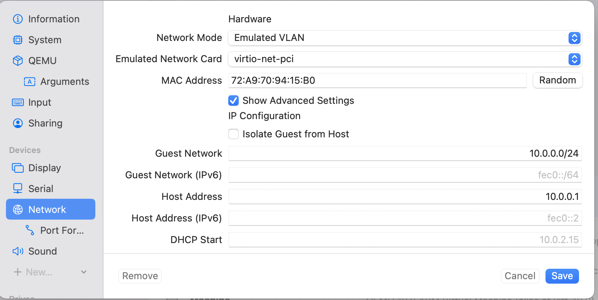
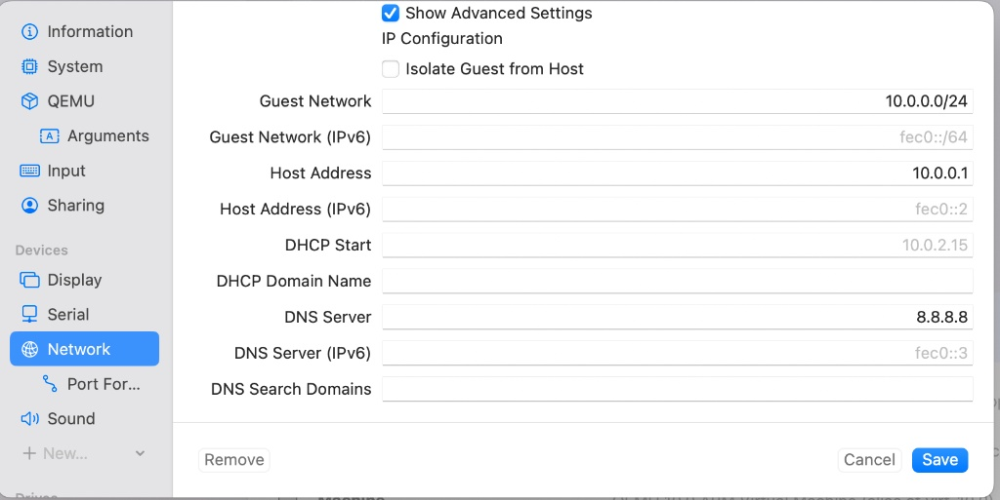
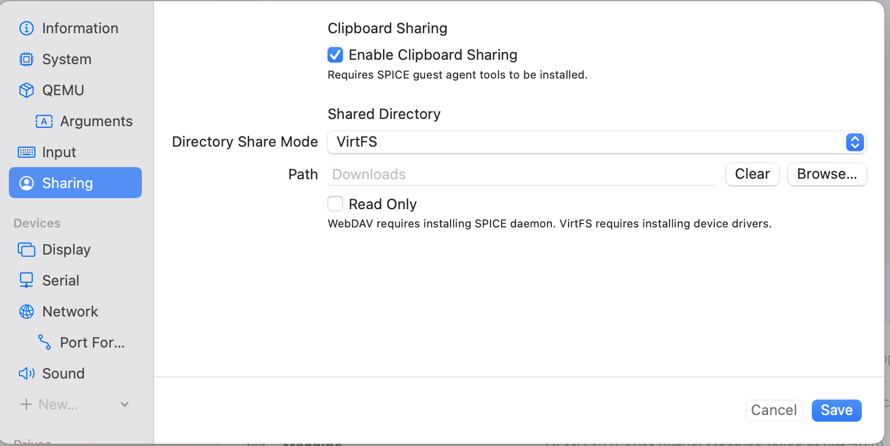
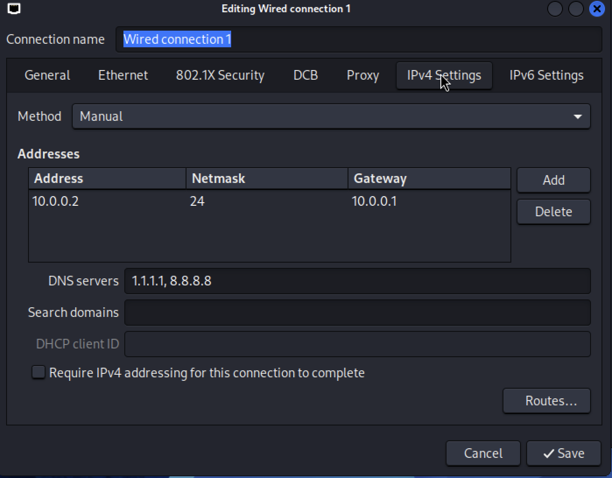
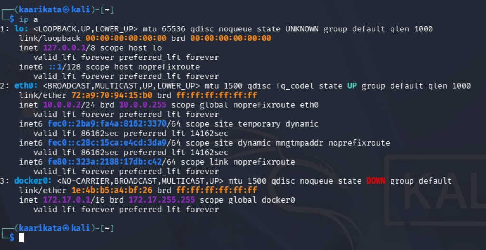
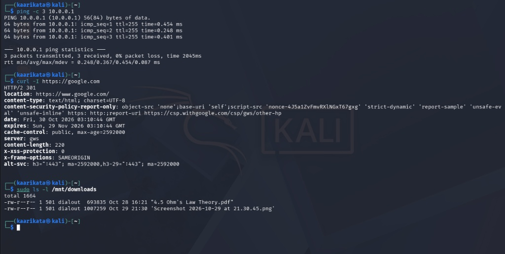
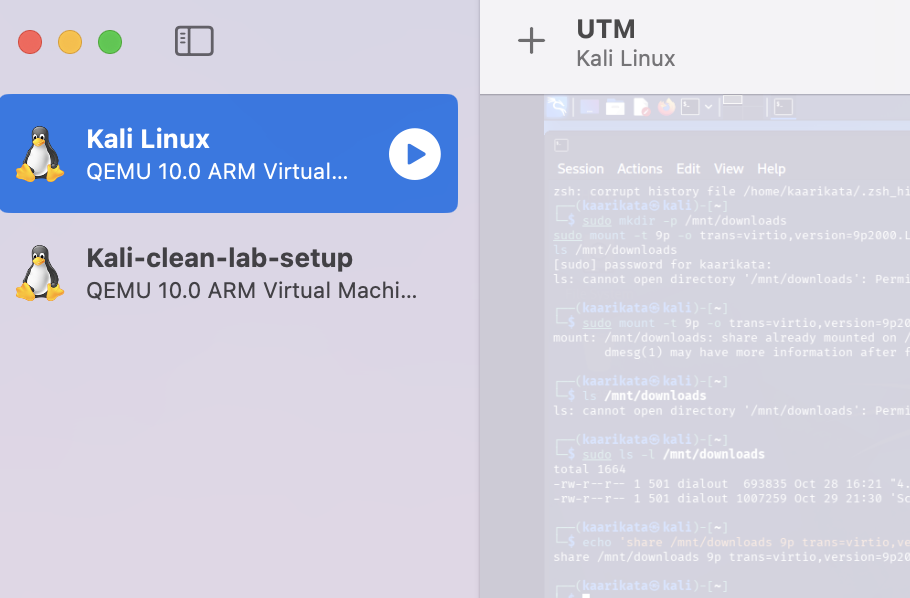

# Cybersecurity Lab Setup — Week 1 Project

## Environment Details

| Component | Specifications |
| :--- | :--- |
| **Host System** | macOS (Apple Silicon ARM64) |
| **Hypervisor** | UTM Virtual Machine Software (v4.x / QEMU 10.0) |
| **Guest OS** | Kali Linux (ARM64) |
| **VM Resources** | 4 Cores CPU / 4096 MB RAM |
| **Network Subnet** | `10.0.0.0/24` (Gateway: `10.0.0.1`, DNS: `8.8.8.8`) |

---

## Architecture & Virtualization Note
This repository contains the complete documentation, configuration details, and verification screenshots for the **Networkwalks Cybersecurity Week 1 Lab Setup**. 

Due to using an **Apple Silicon (ARM64) Mac host**, this lab environment was configured using **UTM Virtual Machine Software** instead of VirtualBox. UTM's **Emulated VLAN** mode was chosen as the **closest equivalent** to VirtualBox's **NAT Network** mode, establishing a private guest subnet (`10.0.0.0/24`) with host gateway routing (`10.0.0.1`). 

*Note for Phase 2:* Because UTM's Emulated VLAN mode operates on a per-VM basis, multi-VM lab scenarios requiring inter-VM communication will be migrated to UTM Shared Network or Bridged mode.

---

## Task Requirements Checklist

- [x] Configure private virtual network subnet (`10.0.0.0/24`) with gateway `10.0.0.1` and DNS `8.8.8.8`
- [x] Configure Kali Linux VM with a persistent static IP (`10.0.0.2/24`)
- [x] Verify gateway ping (`10.0.0.1`) with 0% packet loss
- [x] Confirm outbound WAN/Internet access via `curl -I https://google.com` (HTTP/2 301)
- [x] Enable Clipboard Sharing in UTM
- [x] Configure persistent host-to-guest directory sharing via VirtFS (`/mnt/downloads` mapped to Mac Downloads)
- [x] Create a clean VM baseline clone (`Kali-clean-lab-setup`) in the UTM library as the VirtualBox snapshot equivalent

---

## Lab Execution & Verification Screenshots

### Step 1: UTM Network Configuration (Hardware & Subnet)
Configured virtual network interface using the `virtio-net-pci` emulated driver set to **Emulated VLAN** mode (`10.0.0.0/24`, Gateway `10.0.0.1`).



---

### Step 2: UTM Network Advanced IP & DNS Settings
Established guest network range (`10.0.0.0/24`), virtual host address (`10.0.0.1`), and static DNS server (`8.8.8.8`).



---

### Step 3: Integration & VirtFS Directory Sharing Settings
Enabled Clipboard Sharing in UTM settings and mapped the host Mac `Downloads` directory via VirtFS.

> *Note on Integration:* Drag-and-drop file transfer is a known limitation in UTM on Apple Silicon; file transfers between host and guest are handled reliably via the VirtFS shared directory.



---

### Step 4: Kali NetworkManager Static IPv4 Setup
Configured `Wired connection 1` in Kali Linux using Manual IPv4 addressing: IP `10.0.0.2`, Netmask `24`, Gateway `10.0.0.1`, and DNS `1.1.1.1, 8.8.8.8`.



---

### Step 5: Network Interface & Static IP Verification
Executed `ip a` in the Kali terminal to verify that interface `eth0` is bound to static IP `10.0.0.2/24`.



---

### Step 6: Gateway Ping, Internet Access, & VirtFS Share Test
Ran validation tests:
1. `ping -c 3 10.0.0.1` — 0% packet loss to the gateway.
2. `curl -I https://google.com` — Successful `HTTP/2 301` status confirming WAN access.
3. `sudo ls -l /mnt/downloads` — Verified file accessibility from the mounted host VirtFS `Downloads` directory.



---

### Step 7: Clean Baseline VM Clone (Snapshot Equivalent)
Duplicated the pristine VM state in the UTM library and saved it as `Kali-clean-lab-setup` as a baseline recovery point (the functional equivalent of a VirtualBox VM snapshot).



---

## Configuration Commands & Persistence Reference

### 1. Clipboard agent (inside Kali)
```bash
sudo apt update && sudo apt install spice-vdagent spice-webdavd
```

### 2. Manual VirtFS mount
```bash
sudo mkdir -p /mnt/downloads
sudo mount -t 9p -o trans=virtio,version=9p2000.L share /mnt/downloads
```

### 3. Persistent mount (/etc/fstab entry)
```
share /mnt/downloads 9p trans=virtio,version=9p2000.L,nofail 0 0
```

### 4. Persistent DNS (NetworkManager)
```bash
sudo nmcli connection modify "Wired connection 1" ipv4.dns "1.1.1.1 8.8.8.8" ipv4.ignore-auto-dns yes
sudo nmcli connection down "Wired connection 1" && sudo nmcli connection up "Wired connection 1"
```

---

## Troubleshooting & Solutions

1. **Gateway unreachable (`Destination Host Unreachable`)**
   - Issue: In UTM's Shared Network mode, Apple's vmnet assigns its own subnet, so the Kali VM's `10.0.0.2` had no gateway at `10.0.0.1`.
   - Fix: Switched to Emulated VLAN and set the Guest Network, Host Address and DNS under Advanced Settings.
2. **DNS lookups timing out**
   - Issue: Internet connectivity worked, but `nslookup` timed out because `/etc/resolv.conf` still pointed at the old vmnet DNS address.
   - Fix: Set DNS to `1.1.1.1, 8.8.8.8` and `ipv4.ignore-auto-dns yes` in the NetworkManager connection (command above).
3. **`Permission denied` on the shared folder**
   - Issue: Files on the share are owned by the Mac user (UID 501), while the Kali user is UID `[run id -u]`.
   - Workaround: Used `sudo ls -l /mnt/downloads`.
